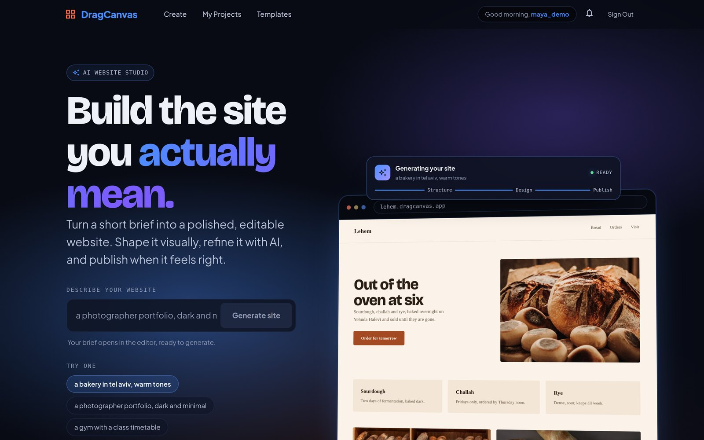
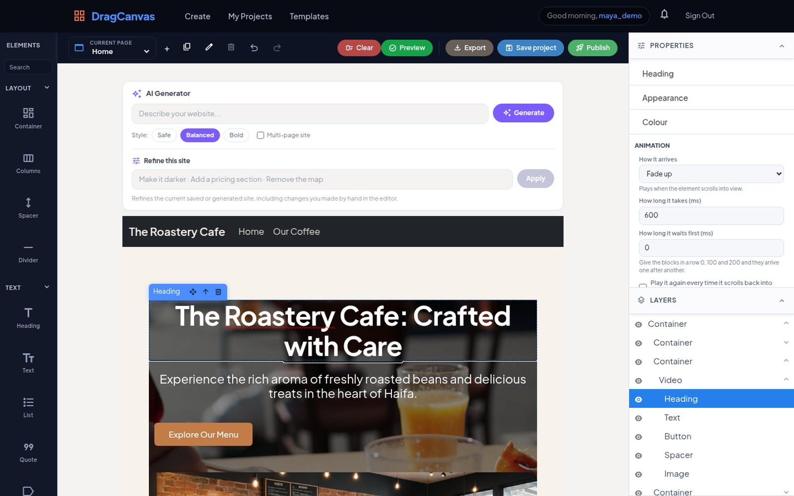
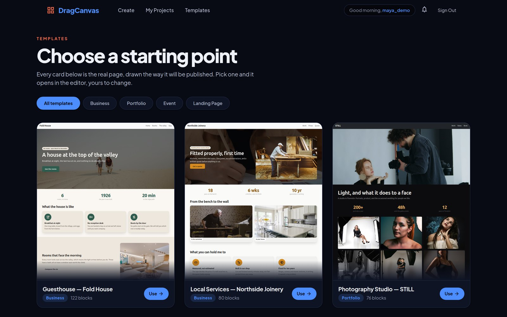
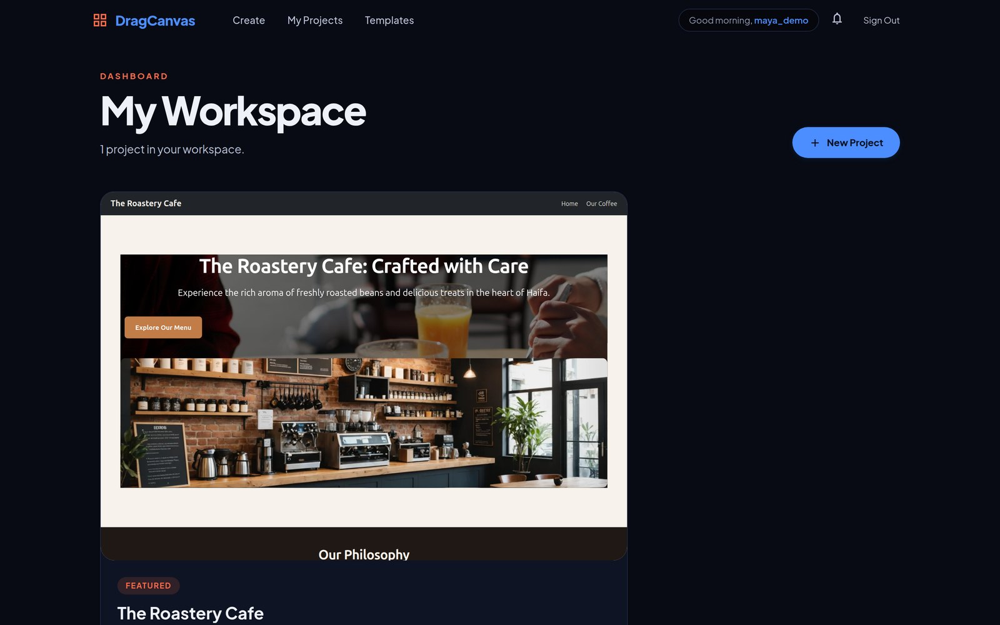
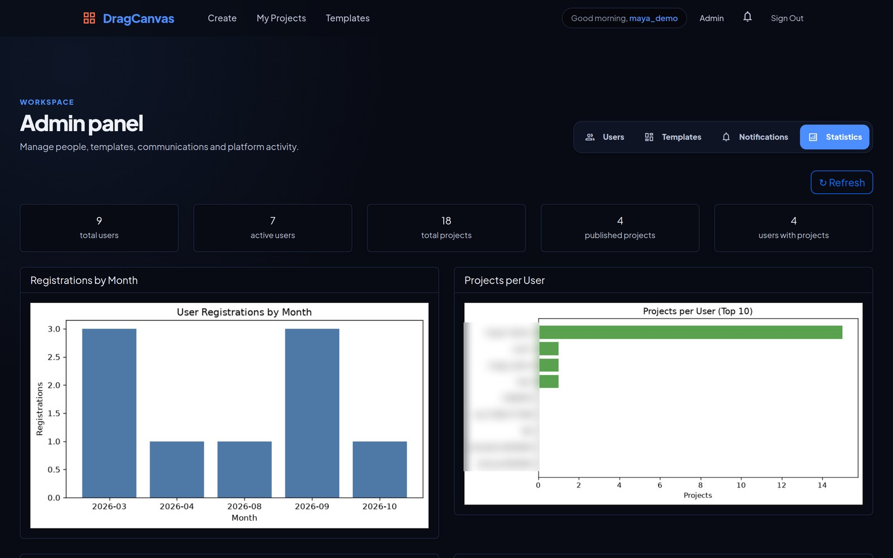

# DragCanvas

A website builder where you describe a site in one sentence, an AI lays it out, and you finish
it by dragging blocks around. When it looks right, one click publishes it as a real website.

**[Open the live app](https://dragcanvasapp.netlify.app)**



## What you can do

- **Generate a site from a brief.** "A specialty coffee roastery in Haifa, warm tones" becomes
  a complete page: sections, copy, and real stock photos and video. Pick a safe, balanced or
  bold style, or ask for a multi-page site.
- **Refine it in plain words.** "Make it darker", "add a pricing section": the AI edits the
  current page, including the changes you made by hand.
- **Edit visually.** A drag-and-drop canvas with layout, text, media and ready-made sections
  (pricing, testimonials, team, timeline, tabs and more). Every block has its own properties,
  appearance and scroll-in animation, and a layers panel shows the page tree.
- **Start from a template** when you would rather not start from a blank page.
- **Publish** to a live address on Netlify, or **export** the page as HTML.
- **Run the site after launch.** Contact form submissions arrive in an inbox and by email, and
  a per-project page shows visits, conversions, leads and bookings.
- **Admin area.** Manage users and templates, send newsletters and scheduled notifications,
  read delivery logs and see platform statistics.

## Screens

**The editor.** Elements on the left, the canvas with the AI generator on top, properties and
layers on the right:



| Templates | My projects |
|:---:|:---:|
|  |  |

**Admin statistics.** Charts drawn by the Python reports service:



## Tech stack

| Part | Technology |
|---|---|
| Client | React 19, Vite, Craft.js (drag-and-drop editor), MUI, React-Bootstrap |
| API | Node.js, Express 5 (ES modules) |
| Database | PostgreSQL on Supabase, through the `pg` driver |
| Auth | JWT, bcrypt |
| AI | ZhipuAI GLM for layout generation and refinement |
| Media | Cloudinary (uploads), Pexels (stock photos and video) |
| Publishing | Netlify API |
| Email and jobs | Nodemailer over SMTP, node-cron for scheduled sends and birthday greetings |
| Reports | Python FastAPI, matplotlib charts, QR codes |
| Hosting | Netlify (client), Render (API and reports) |

## Architecture

```text
React client (Vite, Craft.js editor)
      │
      ├── Node.js / Express  ── PostgreSQL (Supabase)
      │        ├── Cloudinary      uploaded images
      │        ├── ZhipuAI GLM     AI layout generation
      │        ├── Pexels          stock photos and videos
      │        └── Netlify API     publishing a project as a live site
      │
      └── Python FastAPI     ── the same PostgreSQL, read-only reports
               └── matplotlib      charts for the admin panel, QR codes
```

API keys stay on the server: the browser only ever calls DragCanvas's own endpoints, and the
server talks to the AI, media and publishing providers.

## Where the code is

| Folder | What it is |
|---|---|
| **[`DragCanvas-prj/DragCanvas`](DragCanvas-prj/DragCanvas)** | Node.js / Express server and React client. Its [README](DragCanvas-prj/DragCanvas/README.md) lists every API endpoint |
| [`DragCanvas-prj/python-reports`](DragCanvas-prj/python-reports) | Python FastAPI service for admin charts and QR codes |
| [`DEPLOY.md`](DEPLOY.md) | Which variable goes on which service, and what to check once it is live |

## Run it locally

```bash
cd DragCanvas-prj/DragCanvas
npm install
cp .env.example .env      # then fill in the values
npm start                 # API     -> http://localhost:3001
npm run dev               # client  -> http://localhost:5173
```

The minimum to boot the API is `DATABASE_URL` and `JWT_SECRET`. Cloudinary, AI, Pexels, Netlify
and SMTP settings switch on their own features.

## Branches

`main` holds the current code and is what the deployed site runs from. The
`feature/microservices-refactor` branch was merged into it and is kept only as history.
